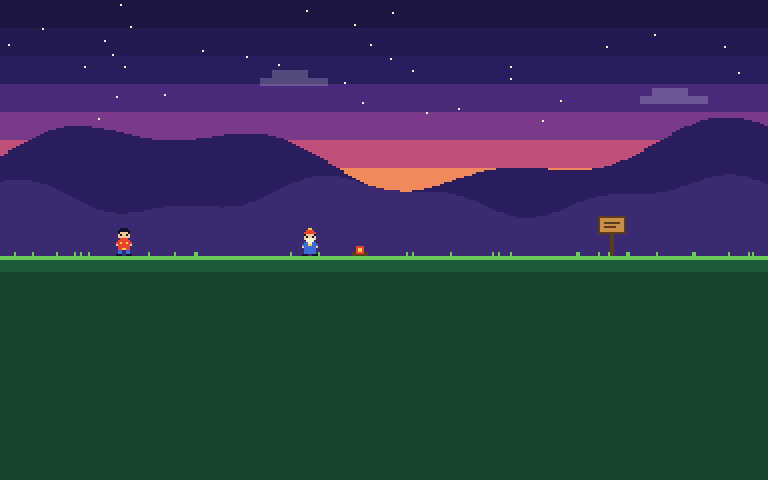

# godot-bichig

Vertical text for the traditional Mongolian script in Godot 4: columns run top to bottom and
follow each other left to right.



*Rendered with godot-bichig 0.1.0 in Godot 4.7.2, set in
[Gege Pixel](https://pixel.gege.mn).*

## Gege Pixel

The font in the picture is [**Gege Pixel**](https://pixel.gege.mn), a pixel font for the
traditional Mongolian script, drawn by hand, pixel by pixel, and made for games: dialogue,
menus, quest logs. It is free for personal use, with licences for commercial games, and this
addon is how it is set in Godot. Every string of the font's test suite is drawn by this addon
exactly as a browser draws it.

The addon is not tied to it: any font that shapes the script works, such as Noto Sans
Mongolian, which the demo ships.

## Why

Godot shapes Mongolian correctly, but only along a horizontal line. Its controls have no
vertical mode, and the text server's `ORIENTATION_VERTICAL` stacks the letters one by one
without joining them. Turning a `Label` a quarter gives the right columns in the wrong order,
right to left.

This addon lets the engine shape each line horizontally, turns it a quarter clockwise, and
lays the columns out left to right. Characters that Unicode stands upright in a vertical line
(CJK, fullwidth forms, `‼`, emoji) are set upright in their `vert` forms, as a browser sets
them under `writing-mode: vertical-lr`.

- `BichigLabel`: a label, with wrapping, an outline and a reveal for dialogue.
- `BichigButton`: a button drawn with the theme's `Button` styles and colours.
- `BichigText`: the layout by itself, to draw vertical text in any node of your own.

## Install

Copy `addons/bichig` into your project and enable **Bichig** under Project Settings → Plugins.
Godot 4.4 or later (tested on 4.4.1 and 4.7.2), with the default (advanced) text server.

## Use

### BichigLabel

```gdscript
var label := BichigLabel.new()
label.font = preload("res://fonts/my_mongolian_font.ttf")
label.font_size = 16
label.text = tr("GREETING")
add_child(label)
```

| Property | |
| --- | --- |
| `text` | A line break starts a new column. |
| `font`, `font_size` | Fall back to the theme's `Label` font and size. |
| `font_color` | |
| `outline_size`, `outline_color` | |
| `autowrap` | Breaks a column longer than the label is tall; off by default, as on a `Label`. The label's minimum width follows the columns. |
| `alignment` | `TOP`, `CENTER` or `BOTTOM` within the label's height. |
| `column_spacing` | Extra pixels between columns. |
| `visible_characters`, `visible_ratio` | Draw only the start of the text. Letters keep the forms they have in the whole word. |
| `language` | Passed to the shaper; `mn` by default. |

A line of dialogue that writes itself out:

```gdscript
label.visible_ratio = 0.0
create_tween().tween_property(label, "visible_ratio", 1.0, 2.0)
```

### BichigButton

A `BaseButton`, so `pressed`, `toggle_mode`, `disabled`, focus and shortcuts work as on any
button. It takes `text`, `font`, `font_size`, `alignment`, `column_spacing` and `language`, and
draws the `normal`, `hover`, `pressed`, `disabled` and `focus` styles and the font colours of
the theme's `Button`.

```gdscript
var button := BichigButton.new()
button.text = tr("START")
button.pressed.connect(start)
```

### BichigText

For a node that draws itself: a name over a character, a sign, a menu of your own.

```gdscript
var title := BichigText.new()

func _ready() -> void:
	title.font = preload("res://fonts/my_mongolian_font.ttf")
	title.font_size = 16
	title.text = tr("TITLE")

func _draw() -> void:
	title.draw_outline(get_canvas_item(), Vector2.ZERO, 1, Color.BLACK)
	title.draw(get_canvas_item(), Vector2.ZERO, Color.WHITE)
```

`get_size()` gives the width of the columns and the length of the longest one, `wrap_height`
breaks columns, and `get_column_count()` counts them. Drawing sets the canvas item's drawing
transform and leaves it at identity; if you set one with `draw_set_transform`, pass it as the
last argument of `draw` and `draw_outline`.

### Wrapping

A column breaks where the text may break, as in a browser: at a space, never before a closing
mark or an upright `？`, and a space at the end of a column does not count against its length.
A word longer than the column is left whole.

### Pixel fonts

Import the font with antialiasing off, hinting none and subpixel positioning disabled, use a
whole multiple of its design size, and keep the label at whole-pixel positions. The label
turns the text with an exact matrix, so every pixel stays on the grid.

For Gege Pixel and Gege Pixel Shahaa the design size is 16: use 16, 32, 48 and so on. At a
size between them a stroke of one pixel comes out one pixel thick in one place and two in
another, as with any pixel font.

An outline on such a font is the engine's own, as on a `Label`: without antialiasing a
one-pixel outline comes out uneven.

## Demo

Open the project in Godot and run it: a hero walks past six things, and each fills a dialogue
box column by column. Walk with the arrow keys, or leave it and the hero walks on alone. It
ships Noto Sans Mongolian (SIL OFL, see `demo/fonts/OFL.txt`). To try another font, pass it
and its size:

    godot --path . -- path/to/font.ttf 16

Two more scenes take the same arguments and a window scale:

- `demo/demo.tscn`: a wrapped label that reveals itself, with two buttons.
- `demo/compare.tscn`: the same text as a `Label` turned a quarter, in the text server's
  vertical orientation, and as a `BichigLabel`.

      godot --path . res://demo/compare.tscn -- path/to/font.ttf 16 2

## Not yet

Text entry, rich text, a caret or selection, icons on buttons, and justified columns.

## Development

`addons/bichig/orientation.gd` is generated from Unicode's `VerticalOrientation.txt`:

    python3 -I tools/orientation.py path/to/VerticalOrientation.txt

### Tests

    godot --path . --script tests/golden.gd

sets every case of `tests/cases.json` (plain words, suffixes, upright marks, brackets, digits,
wrapped paragraphs, the reveal, alignment, spacing, the outline) and compares the pixels with
the approved ones in `tests/golden`, kept as text. It exits with an error when one differs,
and prints both. It opens a window, because the headless renderer draws nothing.

The cases are drawn in Noto Sans Mongolian, where a few pixels in a hundred may differ from
one engine version to another, and in Gege Pixel, pixel for pixel, when the font is at
`$GEGE_PIXEL_FONT` or in `../gege-pixel-font/dist`. After a change that is meant to be seen,
look at it, then approve:

    godot --path . --script tests/golden.gd -- --approve

`tests/render.gd` sets a list of texts and writes the pixels back as text, to compare with
another renderer.

## License

MIT, © 2026 L'Atelier Gege LLC. The demo font is under the SIL Open Font License.
